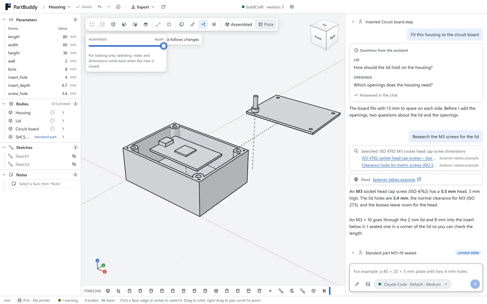
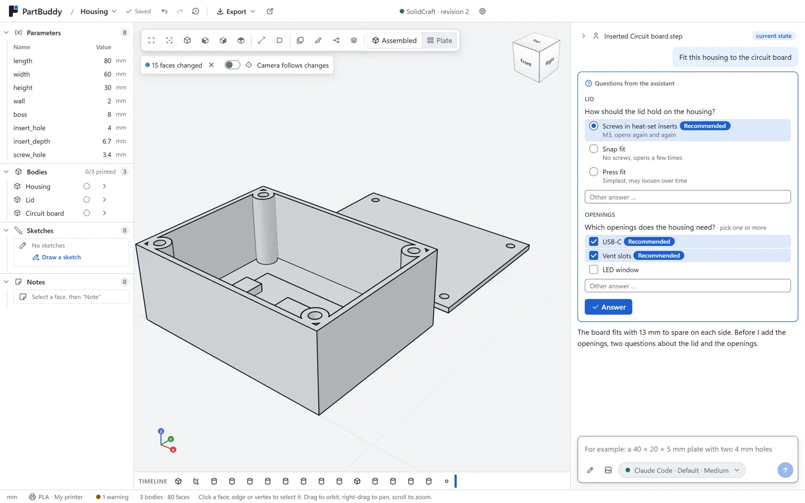
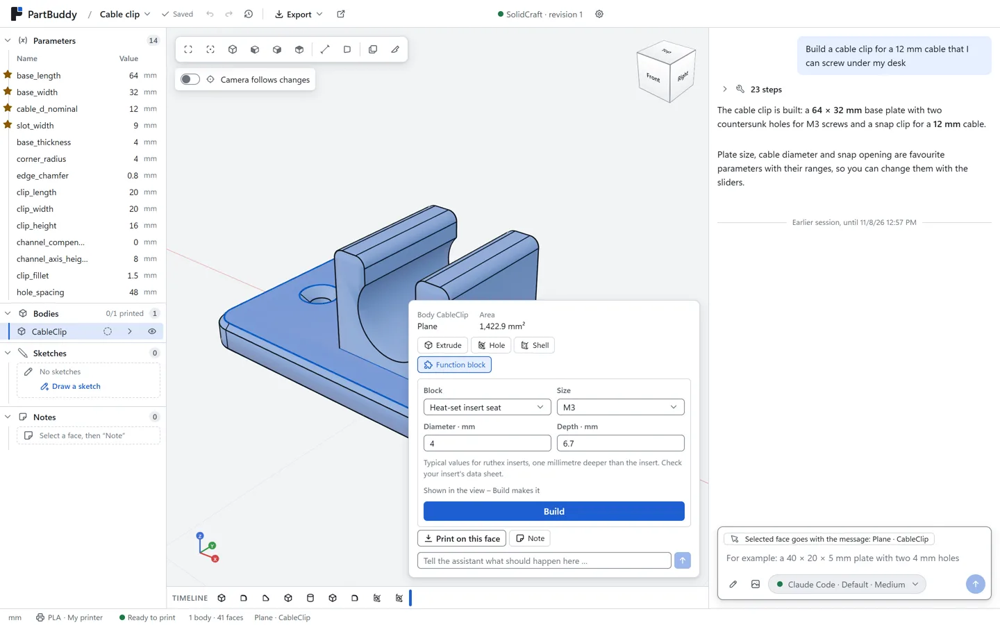
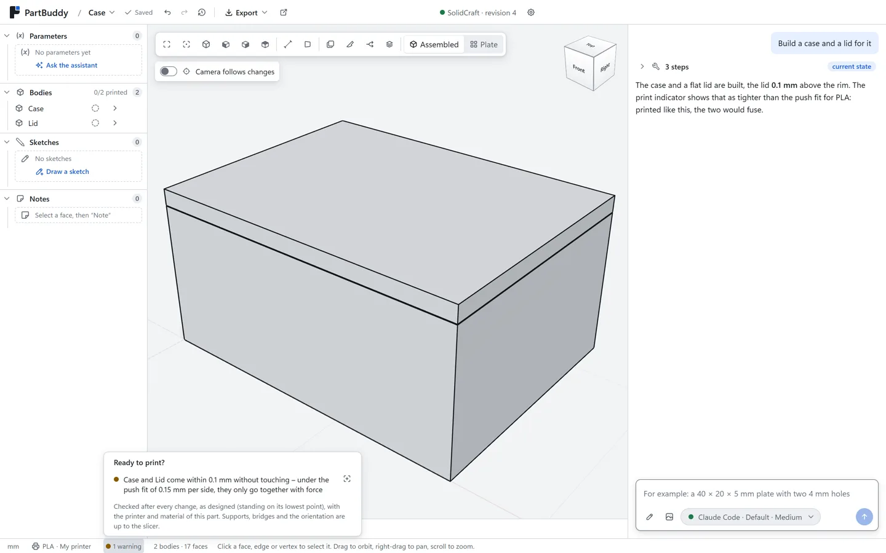
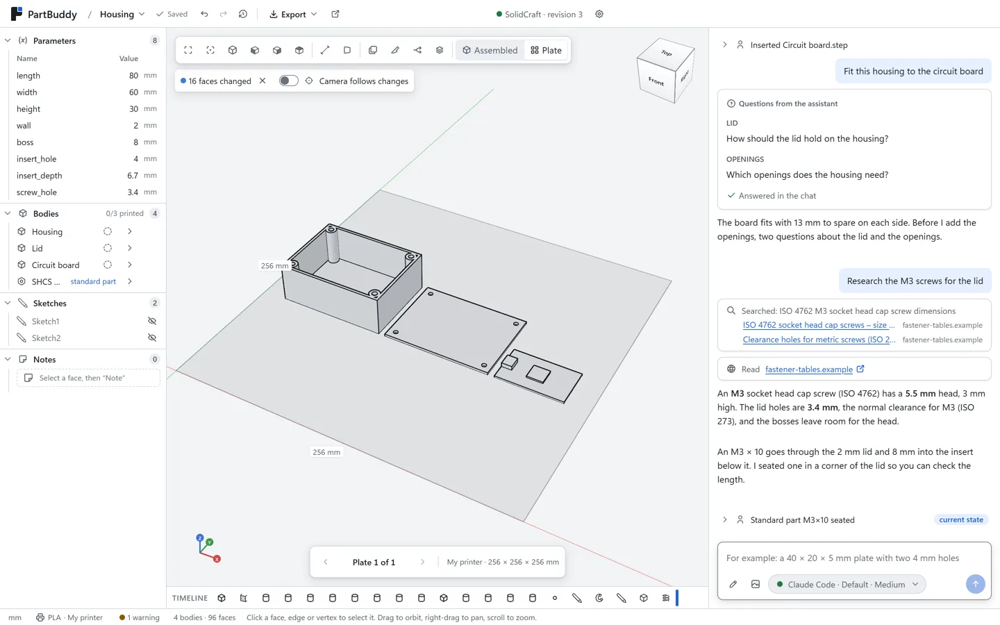
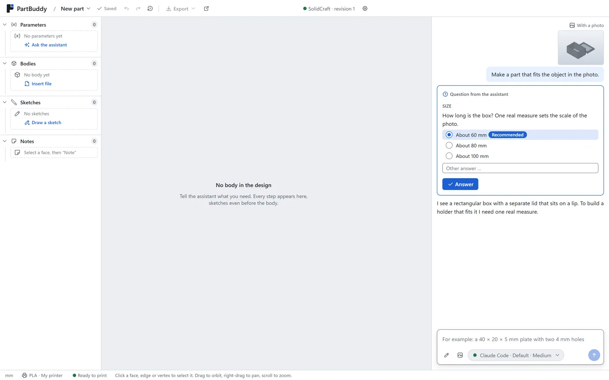
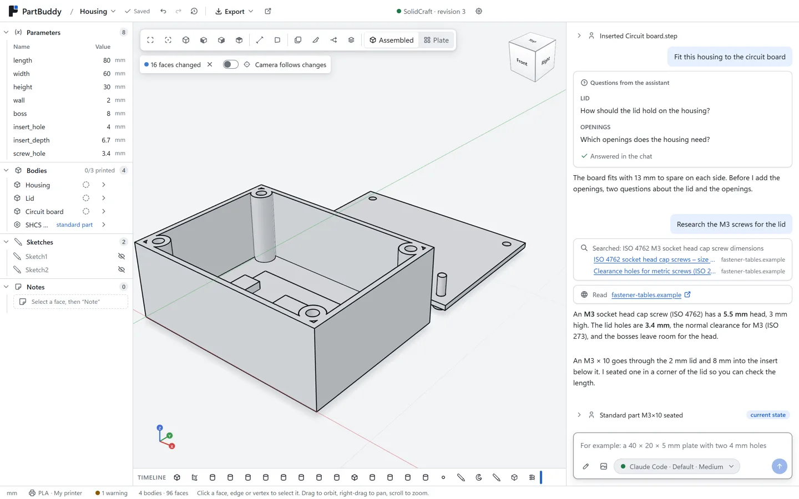

# <picture><source media="(prefers-color-scheme: dark)" srcset="assets/brand/svg/logo-inverse.svg"></picture>

[](https://github.com/PartBuddy/partbuddy/releases/latest)
[](https://github.com/PartBuddy/partbuddy/actions/workflows/ci.yml)
[](https://github.com/PartBuddy/partbuddy/actions/workflows/privacy.yml)
[](https://github.com/PartBuddy/partbuddy/actions/workflows/security.yml)
[](LICENSE)

**Parts that fit. First print.** PartBuddy is a free desktop app for designing parts for FDM 3D
printing together with an AI assistant, in real CAD. Describe the part, answer the assistant's
questions, and watch it being built step by step in the [SolidCraft](https://solidcraft.io) CAD
kernel. Every step appears in PartBuddy's own 3D view, sizes stay editable parameters, and the
ready-to-print check tells you before the slicer does whether the part will print.

Website: [partbuddy.github.io](https://partbuddy.github.io/)

<picture>
  <source media="(prefers-color-scheme: dark)" srcset="docs/screens/app/explode-dark.webp">
  
</picture>

## Download

PartBuddy 0.1.0 is the first preview, for Windows 10 and 11.

1. **PartBuddy:** download `PartBuddy-Setup-0.1.0.exe` from the
   [latest release](https://github.com/PartBuddy/partbuddy/releases/latest) and run it. It installs
   for your user only and checks for updates through the releases page. The installer is not
   code-signed yet, so Windows SmartScreen warns once: choose "More info", then "Run anyway".
2. **SolidCraft 0.41.0:** PartBuddy designs in the free SolidCraft CAD kernel. Install
   [SolidCraft 0.41.0](https://github.com/tangency-labs/solidcraft/releases/tag/v0.41.0)
   (`SolidCraft-0.41.0-windows-x64.exe`). PartBuddy needs 0.40.1 or newer; older versions,
   the 0.40.0 pre-releases included, are refused.
3. **An assistant:** your Claude subscription through [Claude Code](https://claude.com/claude-code),
   your ChatGPT subscription, or a local model. The first start walks you through all three steps.

## What it does

- **It asks before it guesses.** The assistant designs a first concept, then asks the two or three
  sizes that decide the part, as cards with options and a recommendation.
- **Real CAD, built while you watch.** Every step runs in SolidCraft and shows in the 3D view;
  sizes are named parameters you can change in the table without the assistant. Point at a face or
  edge and the request goes with your message.
- **Checked against your printer.** The ready-to-print light checks the build volume of your
  printer, walls the nozzle cannot print, overhangs by angle, what lies on the bed and the clearance
  between parts. Material profiles come from a catalogue of 17 types, printers from 70 makers'
  data sheets, and three test pieces measure your own fits and overhang.
- **Function blocks at a face:** threads and tapped holes, heat-set insert seats, screw bosses,
  snap fits, lids with lip or groove, countersunk holes, nut traps, slots, text and SVG logos.
- **Designed for printing by default:** chamfers on the bed, rounded edges, print-in-place gaps and
  sizes snapped to whole lines and layers of your printer.
- **Sketch the sizes, start from a photo.** Draw a rough sketch with dimensions on squared paper or
  attach a photo of the real object; the assistant asks for what neither shows.
- **Build around real parts.** Import STEP, IGES, STL, 3MF and OBJ, for example a circuit board to
  build a housing around, and seat standard screws, nuts, washers, pins and bearings.
- **Pull it apart, watch it go together.** For prints of several parts: an exploded view, the
  assembly played step by step, and the parts laid out on the plate of your printer.
- **Research with sources.** The assistant can search the web for data sheets and dimensions and
  shows its sources as cards.
- **Versions you can compare,** projects with tags and favourites, a sharing package with 3MF, STEP,
  pictures and a description, and "Open in Bambu Studio / OrcaSlicer".
- **Pick model and effort.** Use your existing Claude or ChatGPT subscription, or a local model on
  your computer through Ollama, LM Studio, llama.cpp or vLLM; nothing leaves it then.

| | |
| --- | --- |
| <picture><source media="(prefers-color-scheme: dark)" srcset="docs/screens/app/clarify-dark.webp"></picture><br>Questions as cards before it builds | <picture><source media="(prefers-color-scheme: dark)" srcset="docs/screens/app/blocks-dark.webp"></picture><br>Function blocks at a picked face |
| <picture><source media="(prefers-color-scheme: dark)" srcset="docs/screens/app/printready-dark.webp"></picture><br>Ready to print, checked against your printer | <picture><source media="(prefers-color-scheme: dark)" srcset="docs/screens/app/plate-dark.webp"></picture><br>Straight to the plate |
| <picture><source media="(prefers-color-scheme: dark)" srcset="docs/screens/app/photo-dark.webp"></picture><br>Start from a photo | <picture><source media="(prefers-color-scheme: dark)" srcset="docs/screens/app/research-dark.webp"></picture><br>Research with sources |

## Status

PartBuddy is a preview (0.x): everything above works and is covered by automated tests, but PartBuddy is
young. Known limits:

- Windows only for now; the installer is not code-signed.
- The ready-to-print light checks the part as designed, standing on its lowest point; supports,
  bridges and the orientation in detail stay with your slicer.
- Hinges and guides the assistant builds are designed to print in one piece and are checked through
  their range in SolidCraft; they have not been test-printed yet, so print
  one before you rely on the gap.

What comes next is planned in the [feature catalogue](docs/feature-catalog.md); changes are listed
in the [changelog](CHANGELOG.md).

## Development

Requirements and rules: [CONTRIBUTING.md](CONTRIBUTING.md). Node 26.13.1 and pnpm 12.16.1; the
contract tests and the website pictures need SolidCraft installed.

```sh
pnpm install                                  # also installs the Git hooks
pnpm --filter @partbuddy/desktop dev          # run the desktop app
pnpm lint && pnpm typecheck && pnpm test      # all packages
pnpm --filter @partbuddy/desktop test:e2e     # Playwright flows against a fake SolidCraft
pnpm --filter @partbuddy/desktop dist         # Windows installer in apps/desktop/dist
```

```text
apps/desktop/  the Electron app: main process with the SolidCraft supervisor and the assistants,
               renderer with the 3D view, tests and Playwright flows
packages/      geometry (meshes, ready-to-print check), design tokens
prototypes/    the early click dummy, never imported by the app
docs/          architecture, ADRs, feature catalogue, design system, brand, engineering notes
site/          content of the website, kept in step with the app
tools/         brand assets, licence notices, privacy scan, CI runner, test version, templates
```

How it fits together: [architecture](docs/architecture.md) and the
[decision records](docs/adr/).

## Security and privacy

See [SECURITY.md](SECURITY.md). PartBuddy has no account and no telemetry; it talks to the
assistant you choose and, for updates, to GitHub. Every commit is scanned for secrets and personal
data before it is created and again in CI ([ADR 0009](docs/adr/0009-privacy-guardrails.md)).

## Code signing policy

Free code signing provided by [SignPath.io](https://about.signpath.io), certificate by
[SignPath Foundation](https://signpath.org). What is signed, who approves a signature and what the
program sends where: [code signing policy](docs/code-signing-policy.md).

## Licence

Copyright (C) 2026 ManuelStaggl and contributors.

PartBuddy is free software: you can redistribute it and/or modify it under the terms of the GNU
General Public License as published by the Free Software Foundation, either version 3 of the
License, or (at your option) any later version. It is distributed in the hope that it will be
useful, but WITHOUT ANY WARRANTY; see [LICENSE](LICENSE) for details. Third-party components and
their licences are listed in [building blocks](docs/building-blocks.md) and shipped with the app as
`THIRD-PARTY-NOTICES.txt`.

## Support

PartBuddy is free and stays free. If it helps you, you can support its development through
[Ko-fi](https://ko-fi.com/partbuddy). Donations buy no features or priority.
