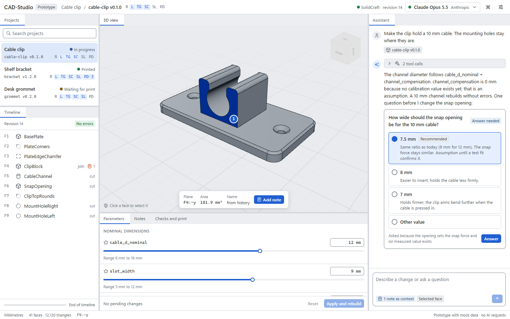

# CAD-Studio

[](https://github.com/ManuelStaggl/cad-studio/actions/workflows/ci.yml)
[](https://github.com/ManuelStaggl/cad-studio/actions/workflows/privacy.yml)
[](https://github.com/ManuelStaggl/cad-studio/actions/workflows/security.yml)


Desktop app for AI-assisted parametric design of FDM 3D-print parts. An assistant builds the part
step by step in the SolidCraft CAD kernel while CAD-Studio mirrors every step in its own 3D view.
Notes pinned to faces, edges and features become context for the assistant; clarifying questions
arrive as cards with options and a recommendation; every part carries honest verification levels
from "created" to "confirmed by print". Users choose their model freely: cloud providers with their
own API key or local servers such as Strata, Ollama or LM Studio.

"CAD-Studio" is a working title; the product name is not decided yet.



## Status

Phase 1 (research, concept, click dummy, repository) is complete; no product code exists yet.

| Area | State |
| --- | --- |
| Research and decisions | [Research](docs/research.md), [building blocks](docs/building-blocks.md), [ADRs](docs/adr/) (0001 and 0009 accepted, the others proposed) |
| Concept | [Architecture](docs/architecture.md), [design system](docs/design-system.md), [feature catalogue](docs/feature-catalog.md) |
| Click dummy | [`prototypes/clickdummy`](prototypes/clickdummy): main view with mock data, real sample geometry |
| Repository | CI, privacy and security checks, release automation; [GitHub setup](docs/github-setup.md) pending |

## Repository layout

```text
.github/       workflows, issue forms, pull request template, CODEOWNERS
docs/          research, building blocks, architecture, design system, ADRs, screenshots
packages/      shared TypeScript packages (design tokens)
prototypes/    click dummy, never imported by product code
tools/         sample-model generator, privacy scan helper, licence gate, GitHub setup script
```

`apps/` (Electron desktop app, Python sidecar) is added with the MVP. The structure is explained in
[ADR 0003](docs/adr/0003-repository-structure.md).

## Development

Requirements and rules: [CONTRIBUTING.md](CONTRIBUTING.md). In short:

```sh
pnpm install                                   # Node 26.13.0, pnpm 12.16.1; installs Git hooks
pnpm --filter @cad-studio/clickdummy dev       # click dummy on http://localhost:5173
pnpm lint && pnpm typecheck && pnpm test && pnpm build
pnpm --filter @cad-studio/clickdummy test:e2e  # Playwright flows, console and accessibility checks
```

The sample model is regenerated with `node tools/fixtures/generate.mjs <output-dir>` (needs the
SolidCraft CLI); CI uses the committed files.

## Security and privacy

See [SECURITY.md](SECURITY.md). Every commit is scanned for secrets and personal data before it is
created and again in CI ([ADR 0009](docs/adr/0009-privacy-guardrails.md)).

## Licence

Proprietary, all rights reserved ([LICENSE](LICENSE)). Third-party components and their licences are
listed in [building blocks](docs/building-blocks.md).
