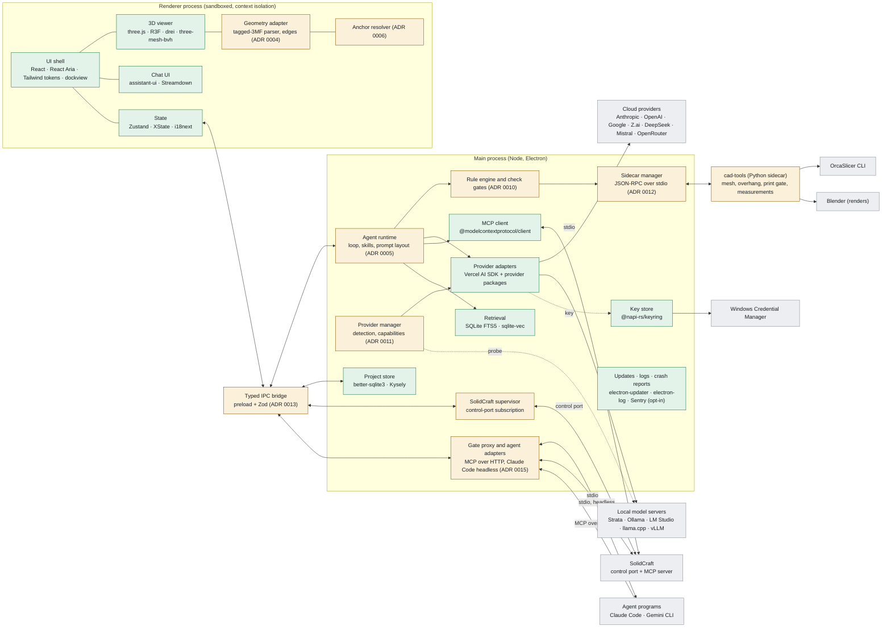
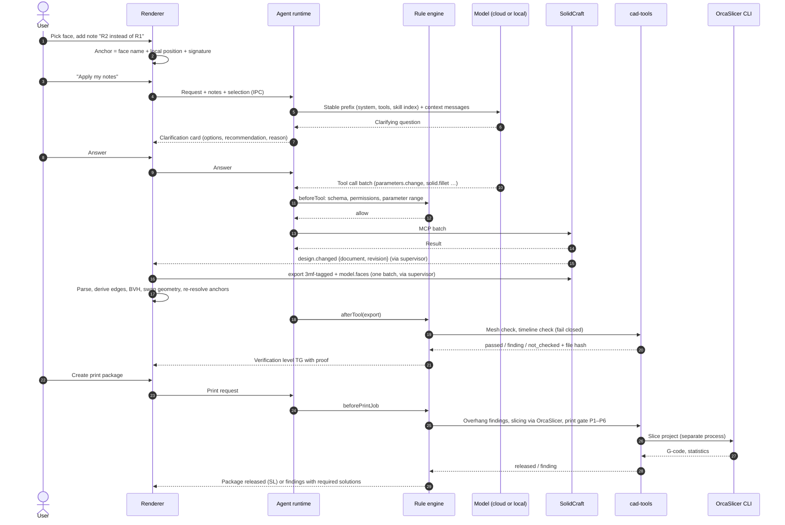
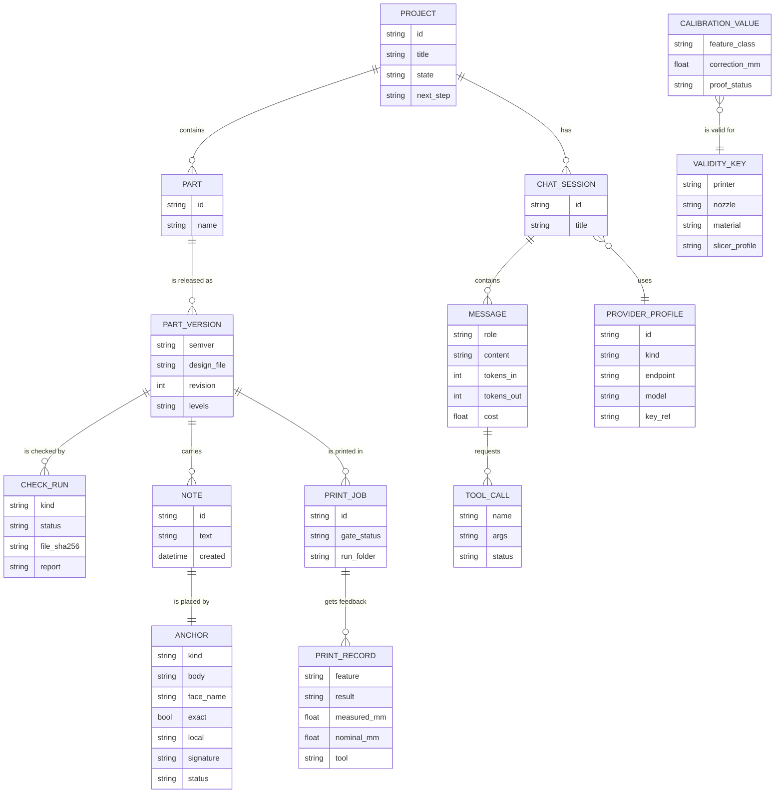

# Architecture

Status: proposal for the MVP (2026-11-04). Decisions behind it: [ADRs](adr/). Every component in
the diagram has a row in [building blocks](building-blocks.md).

## Components

Green: ready-made building block. Orange: own implementation (domain logic or glue, each with an
ADR). Grey: external programs and services, installed or chosen by the customer.

Responsibilities:

| Component | Owns | Never does |
| --- | --- | --- |
| Renderer | Layout, viewer, chat display, forms, local UI state | Holds API keys, spawns processes, reads arbitrary files |
| Typed IPC bridge | The only channel between renderer and main, schema-validated | Generic `invoke`, pass-through of file paths outside projects |
| Agent runtime | Steps, streaming, tool-call validation, compaction, permissions | Lets the model skip a gate |
| Rule engine | Hooks and gates around tool calls (export → mesh check, print → gate) | Interprets free text |
| SolidCraft supervisor | Process detection, `control.subscribe`, revision tracking, mirror requests | Model geometry itself |
| Sidecar | Numerical checks with tested Python libraries | Sees provider keys |
| Gate proxy | The only SolidCraft access of external agents; tool policy on every call | Hands out SolidCraft's own MCP server or reads agent credentials |

## Data flow: from a note to a print package

Latency budget per step (measured headless, see [research § 2.2](research.md#22-latency)): SolidCraft
rebuild 0.4 s to 23 s depending on the part; mirror pipeline 70 ms to 0.7 s on top. The viewer keeps
the previous revision visible with a "rebuilding" state and never blocks.

## Data model

Rules carried over from the earlier workflow:

* Nominal dimensions and print compensation are separate parameters; compensation comes only from
  calibration values with a complete validity key.
* A verification level (R, L, TG, SC, SL, PD) is shown only with its proof; PD shows the number of
  print records.
* Check results are tied to the file hash they were computed on; a changed file resets the levels.

## Where user data lives at runtime

Nothing of this is part of the repository.

| Data | Location (Windows) | Notes |
| --- | --- | --- |
| Settings | `%APPDATA%\PartBuddy\settings.json` | electron-store with schema |
| Projects index, chats, notes, check results | `%APPDATA%\PartBuddy\studio.db` | SQLite, migrations with Kysely |
| User skills and rules | `%APPDATA%\PartBuddy\skills\`, `rules\` | Agent Skills format, JSON rules |
| Mirrored meshes, thumbnails | `%LOCALAPPDATA%\PartBuddy\cache\` | Disposable, keyed by document and revision |
| Logs | `%LOCALAPPDATA%\PartBuddy\logs\` | electron-log rotation; no prompts, keys or personal data |
| Python environment | `%LOCALAPPDATA%\PartBuddy\sidecar\` | Created offline from the bundled wheelhouse |
| Project files (designs, exports, print packages) | User-chosen folder, default `Documents\PartBuddy` | Plain files the user owns |
| API keys and ChatGPT tokens | Windows Credential Manager, target `PartBuddy/<profile id>` (ChatGPT: `PartBuddy/chatgpt/tokens#n`, chunked) | Never in files, logs, crash reports or command lines |
| ChatGPT host ID | `%APPDATA%\PartBuddy\chatgpt-host-id` | Opaque `urn:uuid`, not a credential |
| Crash reports | Local minidumps; uploaded only after opt-in | Scrubbed of paths and user names |

## Provider policy

* Every provider is used with the customer's own key or local server; there is no PartBuddy cloud
  in the request path.
* The provider manager shows per profile: data location, training default for API traffic, and
  whether images may be sent. Providers that store data outside the EU or train on API data by
  default (for example DeepSeek) are off until the user enables them after a notice.
* Photos are stripped of metadata (GPS, device serials) before they leave the machine.
* A local-only mode disables all cloud profiles.
* Subscription plans ([ADR 0015](adr/0015-subscription-access.md)): Claude through the user's own,
  unmodified Claude Code with its own sign-in; ChatGPT through Sign in with ChatGPT; Gemini through
  the user's Gemini CLI. PartBuddy never offers Claude.ai or Google sign-in itself and never reads
  those credentials.

## Security boundaries

* Renderer: sandbox, context isolation, no Node integration, strict content security policy, no
  remote content in privileged windows.
* Electron fuses at package time: RunAsNode off, ASAR integrity on, load only from ASAR.
* Tool calls: schema validation, per-tool permissions (allow, ask, deny), loop guard; gates run in
  the rule engine, not in the model.
* External processes (SolidCraft, OrcaSlicer, Blender, sidecar) start with argument arrays, never
  through a shell with concatenated strings; file paths are checked against the project folder.
