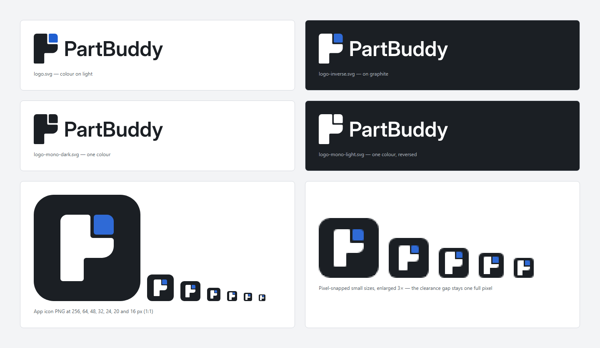
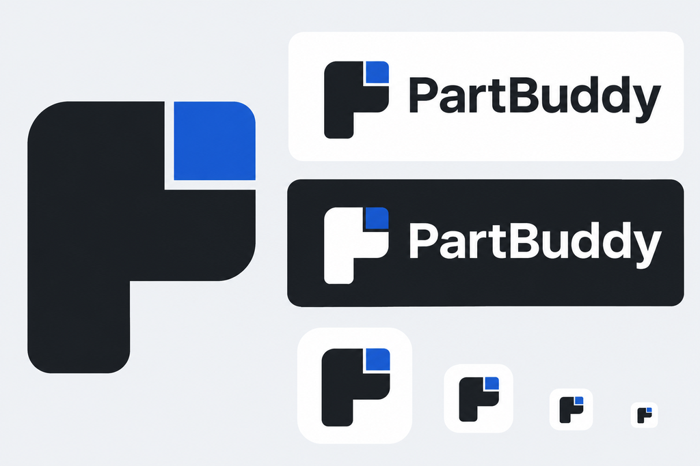
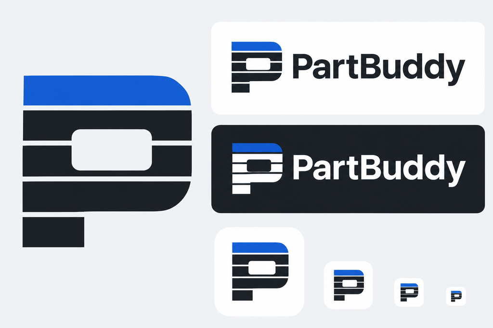
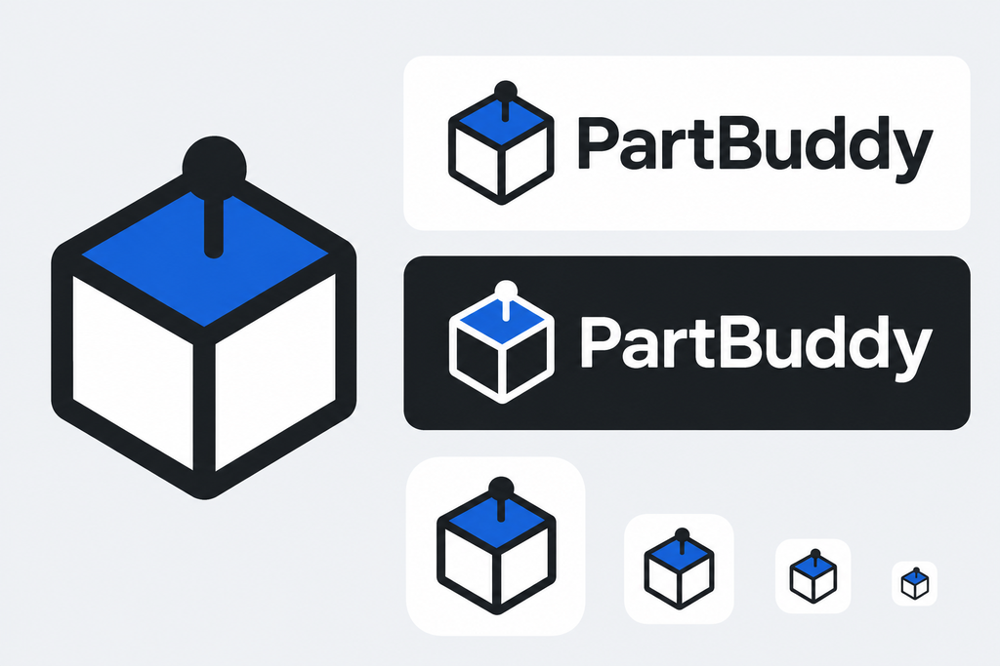

# Brand guide

PartBuddy is a calm, precise tool with a helpful companion at its side. The brand says the same
thing: engineering software first, friendly second, never a toy. This guide covers the mark, the
wordmark, colour, type, imagery, voice and the rules for using them. All files live in
[`assets/brand`](../assets/brand); they are generated from one construction
([`tools/brand`](../tools/brand)) and never edited by hand.



## The idea: "Pair"

The mark shows two parts that belong together. A larger graphite part has a notch in its top right
corner; a small blue companion sits in that notch with an even clearance gap around it. Read
together, the silhouette is a capital **P**.

* **Part and buddy.** The large part is the user's design, the small one the assistant: close,
  fitted to the part, never covering it.
* **The gap is real.** Clearance between mating parts is everyday work in FDM design. The gap is
  part of the mark, not decoration: it stays visible at every size and in every variant.
* **One accent.** The companion is the only coloured element, the same way the UI uses its accent
  only for actions, selection and focus.

Two other directions were explored and set aside (see [concepts](#concepts)): a P built from
print layers (blurred below 32 px) and an isometric cube with a pin (too generic among 3D tools).

## Assets

| File | Use |
| --- | --- |
| `svg/logo.svg` | Primary lockup (mark and wordmark) on white or light grey |
| `svg/logo-inverse.svg` | Lockup on graphite or dark backgrounds |
| `svg/logo-mono-dark.svg`, `svg/logo-mono-light.svg` | One-colour lockup (print, engraving, embossing, monochrome media) |
| `svg/mark.svg`, `svg/mark-inverse.svg`, `svg/mark-mono-dark.svg`, `svg/mark-mono-light.svg` | Mark alone, same colour variants |
| `svg/wordmark.svg`, `svg/wordmark-light.svg` | Wordmark alone, where the mark already appears nearby |
| `svg/app-icon-256.svg` | App icon master (64 px and up) |
| `svg/app-icon-16.svg` … `svg/app-icon-48.svg` | Pixel-snapped app icon sources for 16, 20, 24, 32 and 48 px |
| `icon/partbuddy.ico` | Windows app icon: 16, 20, 24, 32, 40, 48, 64, 96 and 256 px, PNG-compressed entries |
| `icon/png/partbuddy-<size>.png` | App icon as PNG, 16 to 256 px (installer, store listings, docs) |
| `favicon/favicon.svg`, `favicon/favicon.ico` | Browser favicon (SVG on the 16 px grid; ICO with 16, 32, 48 px) |
| `social/social-preview.svg`, `social/social-preview.png` | GitHub social preview, 1280 × 640 px |
| `source/*.json` | Outlined text (wordmark, tagline) produced from the brand font |

All SVGs contain outlines only: no fonts, no external references, no scripts. Each has a `<title>`
and `role="img"` with the name "PartBuddy".

### Regenerating

```sh
node tools/brand/build.mjs
```

The build reads the construction from `tools/brand/geometry.mjs`, the colours from
`packages/design-tokens/src/tokens.css` and the outlined text from `assets/brand/source`, writes
every SVG, renders the PNG and ICO files with the click dummy's Playwright Chromium, copies the
favicons into the click dummy and redraws the overview above. Text outlines change only when the
wording changes:

```sh
uv run tools/brand/outline-text.py <InterDisplay-SemiBold.ttf> assets/brand/source/wordmark.json wordmark=PartBuddy
```

The font file comes from the Inter release named under [typography](#typography); it is not part of
the repository.

## Construction

The master mark sits on a 32 × 40 unit grid (the 256 px app icon uses 4 px per unit).

| Measure | Units | Note |
| --- | --- | --- |
| Width × height | 32 × 40 | Proportion 4 : 5 |
| Stem width | 14 | Vertical stroke of the P |
| Top block | 18 | Right edge of the part above the notch |
| Clearance gap | 2 | Around the companion, left and below |
| Companion | 12 × 12 | Top edge and right edge flush with the silhouette |
| Bowl height | 26 | Bottom of the P's bowl |
| Outer radius | 4 | Top left of the part, top right of the companion |
| Bowl radius | 7 | Lower right of the bowl; makes the silhouette read as a P |
| Minor radius | 1.5 | All other corners, convex and concave |

Below 64 px, the mark is redrawn on the pixel grid (`hinted` in `geometry.mjs`): every edge lies
on a whole pixel and the gap is exactly one pixel (two at 48 px). From 64 px up the master grid is
scaled in whole or half-pixel steps that keep every edge on the grid. Never scale the master down
to a small size; use the matching hinted file.

**App icon.** A graphite tile (corner radius 18.75 % of the size) with the part in white and the
companion in `brand-accent-on-ink`. The mark fills 62.5 % of the tile height. The tile works on a
light taskbar (dark shape) and on a dark one (white mark), so there is one icon for both themes.

**Lockup.** Mark height is twice the wordmark's cap height; the caps are centred on the mark; the
space between mark and wordmark is half the cap height (10 units).

**Clear space.** Keep free space of at least the companion's width (12 units, 30 % of the mark
height) on every side of the mark or lockup.

**Minimum sizes.** Lockup: 20 px mark height on screen, 8 mm in print. Mark alone: 16 px (use the
16 px file), 5 mm in print. Below that, show the name as text.

## Colour

The brand introduces no new hue. Its colours are the UI's own text and accent values, defined as
fixed brand tokens in [`tokens.css`](../packages/design-tokens/src/tokens.css) so that the theme
chooses the logo variant, not the colour.

| Token | Value | Role | Contrast (WCAG 2.2) |
| --- | --- | --- | --- |
| `--cs-brand-ink` | `#1b1f24` | Graphite: the part, the wordmark, dark backgrounds | 16.6:1 on white, 15.1:1 on canvas |
| `--cs-brand-paper` | `#ffffff` | White: light backgrounds, the part on graphite | 16.6:1 on graphite |
| `--cs-brand-accent` | `#1f5fd1` | Blue: the companion on light backgrounds | 5.8:1 on white, 5.3:1 on canvas |
| `--cs-brand-accent-on-ink` | `#2f6ad6` | Blue: the companion on graphite (the dark theme's accent) | 3.3:1 on graphite |
| `--cs-color-canvas` | `#f3f4f6` | Light grey: page background in brand graphics | — |
| `--cs-color-text-muted` | `#545c66` | Secondary text in brand graphics | 6.2:1 on canvas |

`#1f5fd1` reaches only 2.85:1 on graphite, which is why the dark variant uses the dark theme's
accent. The pairs are checked by `packages/design-tokens/test/contrast.test.js` (text 4.5:1, the
companion as an identifying graphic 3:1). In the app, the title bar mark uses the theme tokens
`text` and `accent`, which resolve to the same values.

Status colours (success, warning, danger, info) belong to the UI and never appear in the logo or
in brand graphics.

## Typography

| Use | Typeface | Licence | Source |
| --- | --- | --- | --- |
| Wordmark | Inter Display SemiBold, outlined | SIL Open Font License 1.1 | Inter 4.1 (`Inter-4.1.zip` from the rsms/inter GitHub release v4.1, SHA-256 `9883fdd4a49d4fb66bd8177ba6625ef9a64aa45899767dde3d36aa425756b11e`) |
| Text in brand graphics (tagline, social preview) | Inter Regular and Medium, outlined | SIL OFL 1.1 | same release |
| App UI | Segoe UI Variable, Cascadia Mono | Shipped with Windows | Not bundled ([design system](design-system.md)) |

The wordmark is set as one word with two capitals, **PartBuddy**, with the font's own kerning
(HarfBuzz) and no tracking changes. Inter is close to Segoe UI in proportion, so logo and UI feel
like one product. Segoe UI itself is not used for the logo: its licence does not cover converting
the glyphs into a logo. The OFL allows using outlines made from Inter in a logo; outlined text is
not Font Software and carries no licence obligation, but Inter is credited here.

Inside the app the product name next to the mark is live text in the UI font (`font-display`,
semibold), not the outlined wordmark: it stays crisp at UI sizes, follows the theme and is read by
screen readers.

## Imagery

* **Show the real thing.** The 3D view with real geometry, the timeline, the parameters, real
  printed parts. Screenshots come from the app or the click dummy with the sample model, never
  mock-ups that pretend to be the product.
* **Technical drawing as the graphic language.** Thin construction lines, centre lines, the
  light-grey 32 px grid, orthographic or isometric views. Graphite and white surfaces, at most one
  blue element per image.
* **Photography of printed parts:** neutral backgrounds, daylight-balanced light, the part sharp,
  no props that compete with it, no third-party brands.
* **Generated images** are used only as concepts or clearly labelled illustrations, never as photos
  of printed parts, and never presented as made by hand ([provenance](provenance.md)).
* No glowing brains, robots, sparkles, magic wands, circuit patterns, purple gradients or emoji as
  icons; no 3D-printer or nozzle clip art.

## Voice and tone

PartBuddy talks like an experienced colleague at the next desk: calm, exact, honest about what is
checked and what is assumed. Short sentences, concrete numbers with units, no hype.

| | Do | Don't |
| --- | --- | --- |
| Claims | "Checked in the slicer (SL). Not printed yet." | "Guaranteed to fit!" |
| Assistant | "I'd make the wall 1.6 mm, about four perimeters with a 0.4 mm nozzle. That is an assumption until your profile is known." | "Done! 🎉 Your part is perfect." |
| Errors | "SolidCraft is not running. Start it to continue editing." | "Oops, something went wrong." |
| AI | "The assistant suggests …" | "Our AI magically designs …" |

**German.** Informal "du", as in the UI ([design system](design-system.md)); factual, no
anglicisms where a common German word exists ("Spalt", not "Gap"; "Druckteil", not "Print-Part").
Product name and technical terms stay as they are: PartBuddy, SolidCraft, OrcaSlicer, FDM.

| English | German |
| --- | --- |
| AI-assisted parametric design for FDM 3D printing | KI-gestützte parametrische Konstruktion für den FDM-3D-Druck |
| Your part, step by step. | Dein Bauteil, Schritt für Schritt. |
| Free and open source. | Frei und quelloffen. |

## Using the logo

**Do**

* Use the supplied files unchanged, in the variant made for the background.
* Keep the clear space and the minimum sizes.
* Use the one-colour variants where colour is not available; the gap carries the mark.
* Write the name as **PartBuddy** in running text.

**Don't**

* Recolour, add gradients, shadows, outlines, glows or 3D effects.
* Close the gap, move the companion, rotate, stretch or redraw the mark.
* Put the colour logo on mid-tone or busy backgrounds or on photos without a calm area.
* Set the wordmark in another typeface or as live text in a logo file.
* Write "Part Buddy", "Partbuddy", "PARTBUDDY" or abbreviate it to "PB".
* Use the blue companion alone as a bullet, badge or status sign.

## Concepts

The three directions were generated as concept boards with the image generation of the OpenAI
Codex CLI, then the chosen direction was constructed and drawn as vectors from scratch. The boards
are kept as a record; nothing in them is used as an asset. Prompts and terms:
[provenance](provenance.md#brand-identity).

| B "Pair" (chosen) | A "Layers" | C "Pinned face" |
| --- | --- | --- |
|  |  |  |

## Open points

* **Trademark search.** "PartBuddy" has not yet been checked against the DPMA and EUIPO registers.
  Until then, do not register domains or accounts that would be hard to give up, and do not use
  the ™ sign.
* **GitHub social preview.** GitHub accepts the image only through the repository settings
  (Settings → General → Social preview); upload `assets/brand/social/social-preview.png` there.
