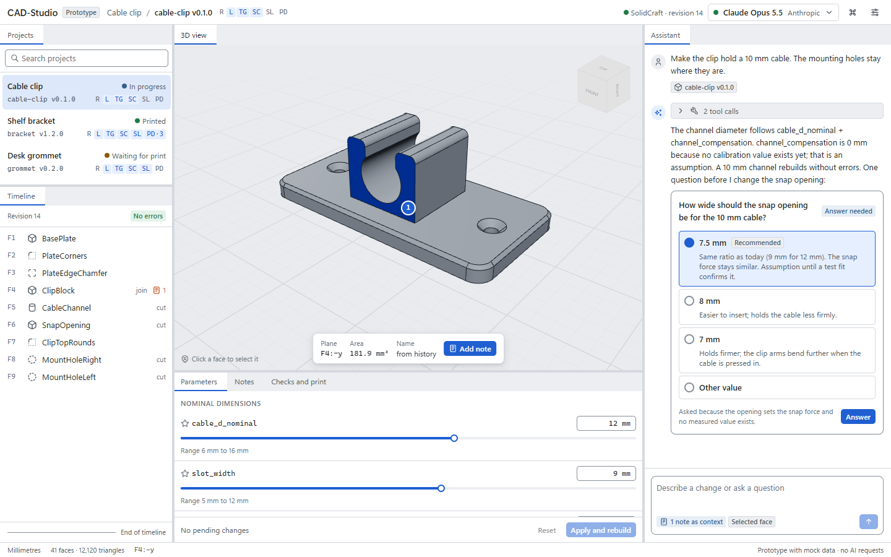

# Design system

The design system builds on [React Aria Components](https://react-spectrum.adobe.com/react-aria/)
(unstyled, accessible primitives) styled with Tailwind CSS v4 utilities that can only express design
tokens. No primitive is rebuilt that React Aria provides. Source of truth for all values:
[`packages/design-tokens`](../packages/design-tokens/src/tokens.css). Screenshots:
[docs/screens](screens/). Logo, app icon, brand colours and voice: [brand guide](brand.md).



## Principles

* **Calm density.** CAD work is long and detailed: 13 px body text, 28 px rows and controls, thin
  borders instead of cards and shadows, no decorative gradients.
* **One accent.** The accent colour marks actions, selection and focus only. Status colours
  (success, warning, danger, info) mark states and always come with text or an icon.
* **The model is the hero.** Panels frame the 3D view; overlays in the view are small and anchored
  to its edges.
* **Honest states.** Every state is designed: empty, loading, error, offline, SolidCraft not running,
  local server not reachable, model without tool calling, context too small, local model still
  reading the prompt. Mock or computed values say where they come from.
* **Domain language from the workflow.** Verification levels R, L, TG, SC, SL, PD; nominal
  dimensions and print compensation shown apart; assumptions labelled as such.

## Tokens

All tokens are CSS custom properties prefixed `--cs-`. Tailwind's default palette, spacing, radii,
fonts and shadows are removed (`tailwind-theme.css`), so a utility class either maps to a token or
produces nothing. ESLint rejects hex colour literals in UI code.

### Colour (light / dark)

| Token | Light | Dark | Use |
| --- | --- | --- | --- |
| `canvas` | `#f3f4f6` | `#15181c` | App background behind panels |
| `surface` | `#ffffff` | `#1c2025` | Panels, inputs |
| `surface-sunken` | `#eceef1` | `#121417` | Tab strips, wells, 3D view frame |
| `surface-raised` | `#ffffff` | `#242930` | Menus, dialogs, popovers |
| `surface-hover` / `surface-selected` | `#e8ebef` / `#dde8fb` | `#2a3037` / `#1d3354` | List rows |
| `border` / `border-strong` | `#d5d9df` / `#878f99` | `#2f353d` / `#6a727d` | Dividers / control outlines (3:1) |
| `text` / `text-muted` / `text-subtle` | `#1b1f24` / `#545c66` / `#6a727c` | `#e7eaee` / `#a9b0b9` / `#939ba5` | Text hierarchy (all ≥ 4.5:1) |
| `accent` / `accent-hover` | `#1f5fd1` / `#1a52b6` | `#2f6ad6` / `#265cbf` | Primary buttons, selection fill |
| `accent-text` / `accent-subtle` | `#1f5fd1` / `#e6efff` | `#7aa7f6` / `#1b2c47` | Accent text, selected backgrounds |
| `focus` | `#1f5fd1` | `#6e9ff5` | Focus ring (2 px, ≥ 3:1) |
| `success`, `warning`, `danger`, `info` (+ `-subtle`) | see tokens | see tokens | States only |
| `viewer-*` | see tokens | see tokens | 3D view background, body, edges, hover, selection, notes, faces changed by the latest step |
| `brand-ink`, `brand-paper`, `brand-accent`, `brand-accent-on-ink` | fixed | fixed | Logo and brand graphics only ([brand guide](brand.md#colour)) |

Contrast is verified by a test (`packages/design-tokens/test/contrast.test.js`) for every text and
control pair in both themes against WCAG 2.2 AA (4.5:1 text, 3:1 non-text). The test found and
forced two fixes during Phase 1: white text on the dark accent (4.0:1) and control borders below 3:1.

### Space, size, type, shape, motion

| Group | Tokens |
| --- | --- |
| Space (4 px grid; layout steps in 8 px) | `space-1` 4 · `space-2` 8 · `space-3` 12 · `space-4` 16 · `space-5` 24 · `space-6` 32 · `space-7` 48 |
| Controls | `control-sm` 24 · `control-md` 28 · `control-lg` 32 · `row-height` 28 · `titlebar` 40 · `statusbar` 24 |
| Type | Segoe UI Variable everywhere, also for names, numbers and code blocks (no monospace in the app, Manuel 2026-11-05 and 2026-11-07; Shiki colours and a sunken surface mark code); sizes 11 / 12 / 13 / 15 / 18 px; weights 400 / 500 / 600; numbers use tabular figures |
| Radii | `sm` 3 · `md` 5 · `lg` 8 · `full` |
| Elevation | `shadow-1` (raised controls), `shadow-2` (popovers, overlays in the view), `shadow-3` (dialogs) |
| Motion | 90 ms and 160 ms with a standard easing; all motion off under `prefers-reduced-motion` |

The UI uses the native Windows fonts; no webfonts are bundled (no licence or download needed).

## Icons

[Tabler Icons](https://tabler.io/icons) (MIT, 24 px grid, 2 px stroke) for the UI at 14 and 16 px.
CAD operations (timeline, selection actions, structure, dimension tool) use the glyphs of
[Zoo Design Studio](https://github.com/KittyCAD/modeling-app) (MIT) through `CadIcon`; they are
generated by `tools/icons/build-zoo-icons.mjs` from one pinned commit
([ADR 0023](adr/0023-cad-icons-from-zoo.md)). Primitives (box, cylinder) and bodies stay Tabler. Icon-only
buttons always have an accessible name and a tooltip with the shortcut.

CAD terms follow common CAD software in both languages:

| English | German |
| --- | --- |
| Sketch | Skizze |
| Extrude | Extrusion |
| Revolve | Rotation |
| Sweep | Austragung |
| Loft | Loft |
| Fillet | Verrundung |
| Chamfer | Fase |
| Hole | Bohrung |
| Shell | Schale |
| Mirror | Spiegeln |
| Linear pattern / circular pattern | Lineares Muster / Kreismuster |
| Split | Teilen |
| Thread | Gewinde |
| Combine | Kombinieren |
| Plane | Ebene |
| Body | Körper |
| Dimension | Bemaßung (tool), Maß (single value) |

## Layout and docking

[dockview](https://dockview.dev) (MIT) provides the panel layout, themed through its CSS variables
mapped onto the tokens.

```text
┌ Title bar: product · project / part · verification · SolidCraft status · model menu · palette · settings ┐
├ Projects ───┬ 3D view ─────────────────────────────────┬ Assistant ───────────┤
│             │  view cube (top right)                   │  messages            │
├ Timeline ───┤  selection bar (bottom centre)           │  tool calls          │
│             │  state banners (top left)                │  clarification card  │
│             ├ Parameters │ Notes │ Checks and print ───┤  composer + context  │
└ Status bar: units · mesh · hovered/selected face · data source ─────────────────────────────┘
```

* Default widths: navigation 240 px, assistant 420 px (drag its left edge between 320 and 760 px;
  the 3D view keeps at least 480 px); the 3D view takes the rest.

### 3D view look ("calm", chosen 2026-11-05)

Chosen by Manuel from a side-by-side of two looks (classic metal on a gradient, calm matte on a
flat ground), with the tone kept neutral rather than warm:

* Neutral light grey matte part (roughness 0.8, no metalness) on a flat background; model edges as
  1.7 px dark lines. Dark theme: the part a step dimmer so it does not glare.
* A new body is not tinted; changed faces get a tint of the change colour. Hover and selection tint
  the face, the outline carries the strong colour.
* World axes: red X and green Y through the origin, an axis triad in the lower left, the view cube
  in the upper right. View tools as one horizontal bar at the top left, above the live chips, so
  nothing overlaps at narrow widths; menus open below it.
  Standard views have cube icons with the viewed face filled. The selection hint lives in the
  status bar, not on the part.
* Selection dock (UI upgrade step 11): everything about a selection sits in one panel docked at
  the bottom centre of the view, never on the part: kind, body, name and measures, the dimension
  field, the actions and Note, the distance between two picks and the wish to the assistant. The
  ghost of a tried value still shows on the part. Dimension labels keep clear of the dock, the
  view tools and the live chips (`data-view-overlay`).
* Timeline (UI upgrade step 14): one icon per step with its name and kind in a tooltip, faded
  when rolled back, crossed when suppressed. The rollback bar sits after the last active step;
  drag it, or move it with the arrow keys and press Enter, and the design rolls back once on
  release (a rebuild can take minutes). A normal part fits without a scrollbar.
* Overhang view (UI upgrade step 12, view tools): faces coloured by how far they lean over when the
  part is printed along +Z on its lowest point: up to 35° from the vertical in the body colour,
  35–45° amber (borderline), beyond 45° red (needs support), faces on the bed green. Curved faces
  shade per vertex. A legend lists the area per class. The print direction will come from M7's
  orientation; until then it is +Z.
* Before/after (UI upgrade step 13): while a value or action is tried, a slider "Now – Preview"
  weighs the part against the ghost of the result. After a change of the geometry, PartBuddy keeps
  the bodies from before it (until the next revision); "Before/after" in the change chip opens a
  slider from the old state to the new one. Each side stays solid for the first half of the way
  (`viewer/blend.ts`), so the ends show one state alone and the middle both.
* Dimensions in their own colour (`viewer-dimension`): extension lines that start off the part and
  run past the dimension line, arrowheads of a fixed screen size, leaders with the arrow on the rim
  for radii and diameters, labels as slim pills (parameter name subtle, value bold).
* Panels can be resized and re-arranged; floating panels are off in the MVP. Keyboard docking is a
  paid dockview feature, so panel moves get own commands in the command palette.
* Tabs have no inline close buttons (nested interactive controls fail WCAG checks); panels are
  closed and reopened through the View menu and the command palette.

## Components

| Need | React Aria component | Notes |
| --- | --- | --- |
| Buttons, icon buttons | `Button`, `TooltipTrigger` | Variants: primary, secondary, quiet, danger; sizes sm/md |
| Menus (model menu, settings) | `MenuTrigger`, `Menu`, `MenuSection` with single selection per section | Menus close on selection |
| Command palette | `Autocomplete`, `SearchField`, `Menu` in a `Modal` | Ctrl+K (react-hotkeys-hook) |
| Lists (projects, timeline, notes) | `ListBox`, `GridList` | Rows with actions use `GridList` |
| Parameters | `NumberField` (locale-aware unit formatting), `Slider` for favourites | Range shown below each value |
| Clarification card | `RadioGroup`, `RadioField`, `RadioButton`, `Text slot="description"` | Recommended option first and marked |
| Dialogs | `ModalOverlay`, `Modal`, `Dialog`, `Heading` | Focus trapped, Esc closes |
| Disclosure (tool calls) | `Disclosure`, `DisclosurePanel` | Collapsed by default |
| Progress | `ProgressBar` (determinate for prompt progress, indeterminate for loading) | Always labelled |
| Toasts | Own `notify()` API over React Aria Toast | Toast is alpha in React Aria; wrapped so it can be swapped |

## States

| State | Where | Design |
| --- | --- | --- |
| Empty | Projects, notes, print profile | Title, one sentence why, one next action |
| Loading | Projects, model | Indeterminate progress with label; skeletons only where layout is known |
| Error | Model file unreadable | Plain-language title and the technical cause in the body |
| SolidCraft not running | 3D view, assistant | Last revision greyed with a warning banner; assistant explains it cannot change the design |
| Rebuilding | 3D view | "Rebuilding in SolidCraft" progress at the top left; old geometry stays visible |
| Local server not reachable | Assistant, model menu | Danger banner with endpoint and next step; composer disabled |
| Context too small | Assistant, model menu | Warning with actual and required context and how to raise it |
| Model without tool calling | Assistant, model menu | Warning: can answer, cannot change the design |
| Local model reading a long prompt | Assistant | Determinate prompt progress with a Stop button |
| Offline (cloud) | Assistant, model menu | Same pattern as "not reachable", with the provider name |

## Keyboard

* All interactive elements are reachable by Tab in reading order; React Aria provides arrow-key
  navigation inside lists, menus, radio groups and sliders.
* Ctrl+K opens the command palette; Esc closes overlays; Enter submits dialogs.
* The 3D view: orbit with the mouse, view cube for standard views; keyboard camera commands
  (fit, standard views) are palette commands with shortcuts in the MVP.

## Accessibility (WCAG 2.2 AA)

* Contrast verified by test for every token pair (see above).
* Focus visible: 2 px focus ring in `focus` colour on every control.
* Status never by colour alone: dots and badges always carry text.
* Accessible names for icon buttons, the 3D view (`role="img"` with a label), sliders and pins.
* Automated check: axe-core (`@axe-core/playwright`) with WCAG 2.0, 2.1 and 2.2 A/AA rules runs in
  CI on the main view and reports no violations at the end of Phase 1. Automated checks do not cover
  every criterion; a manual screen-reader pass (NVDA) is planned for the MVP.
* Target size: interactive targets are at least 24 × 24 px (WCAG 2.2, 2.5.8).

## Localisation

* i18next with ICU MessageFormat (`i18next-icu`) for plurals and numbers; German and English from
  the start, English as fallback.
* Numbers and units through `Intl.NumberFormat` (`12,5 mm` in German, `12.5 mm` in English).
* German UI uses the informal "du", as is common in current German desktop software; this is a
  product decision that can be changed in the message files.
* No text in images; layout allows about 30 % longer German strings (buttons do not have fixed
  widths).
